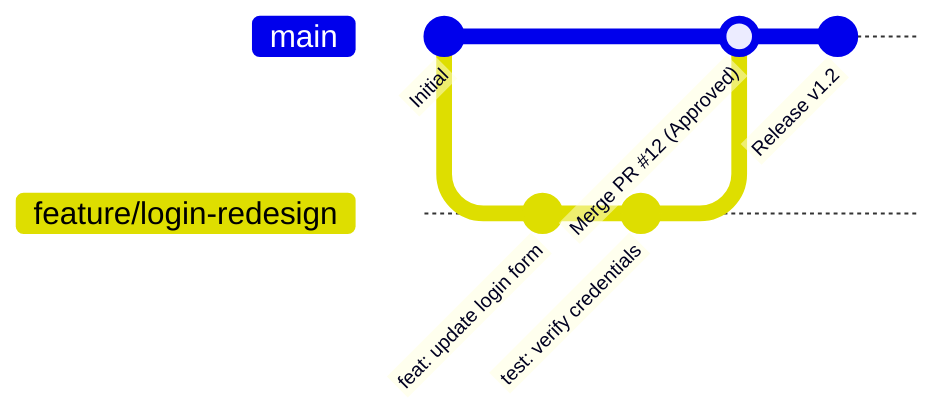

# Panduan Pengaturan Kolaborasi & Tata Kelola Repositori Privat GitHub
## Proyek: PHM One — PT Putra Hatim Mandiri (PHM Group)
**Dokumen ID:** PHM-OPS-COL-001  
**Klasifikasi:** Internal Confidential / Restreint  
**Tanggal Pelaksanaan:** 17 November 2026  
**Penyusun:** Senior GitHub Administrator & DevOps Team  
**Repositori Target:** `ALDILAHzxz/Prototipe-phm` & `ALDILAHzxz/PHM-ONE`  

---

## 1. Ringkasan Eksekutif (Executive Summary)

Setelah repositori dialihkan menjadi **Privat (Private)**, akses pengembangan hanya dapat diberikan kepada anggota tim yang diundang secara eksplisit. Tanpa tata kelola yang terstruktur, kolaborasi pada repositori privat dapat menimbulkan risiko keamanan, seperti komit langsung ke cabang utama tanpa reviu (*direct push to main*), kebocoran kredensial baru, atau konflik cabang.

Dokumen ini menetapkan standar operasional baku (*Standard Operating Procedure* / SOP) untuk:
1. Penambahan dan pengelolaan kolaborator dengan prinsip hak akses terkecil (*Principle of Least Privilege*).
2. Kebijakan proteksi cabang (*Branch Protection Rules*) pada cabang `main`.
3. Standar peninjauan kode (*Code Review & Pull Request Protocol*).
4. Prosedur pelepasan hak akses (*Offboarding Checklist*).

---

## 2. Struktur Peran & Matriks Izin Kolaborator (GitHub RBAC)

GitHub menyediakan 5 tingkatan izin kolaborator untuk repositori. Pada proyek PHM One, izin dialokasikan secara ketat sebagai berikut:

| Peran Tim | Tingkat Izin GitHub | Hak Akses | Contoh Anggota |
|:---|:---|:---|:---|
| **Pemilik Proyek (Project Owner)** | **Owner / Admin** | Akses penuh atas konfigurasi repositori, penambahan kolaborator, dan pengaturan keamanan. | `ALDILAHzxz` |
| **Pimpinan Teknis (Tech Lead)** | **Maintain** | Mengelola cabang, menyetujui dan menggabungkan (*merge*) Pull Request ke `main`. | Lead Developer |
| **Pengembang Inti (Core Developer)** | **Write** | Mendorong cabang fitur (*push feature branch*), membuat Pull Request, mengedit kode. | Frontend/UI Engineer |
| **QA / Penguji Kegunaan** | **Triage** | Membuka Issue, memberi label bug, meninjau status pengujian tanpa hak menulis kode. | QA Specialist |
| **Pemangku Kepentingan (Stakeholder)** | **Read** | Melihat kode sumber dan laporan audit tanpa izin memodifikasi. | Dosen Pembimbing / Auditor |

---

## 3. Aturan Proteksi Cabang Utama (`main` Branch Protection Rules)

Untuk mencegah kerusakan pada lingkungan produksi `https://phmoneproto.vercel.app`, cabang `main` **WAJIB** dilindungi dengan aturan proteksi berikut:

### Langkah Konfigurasi pada GitHub:
1. Buka Repositori di GitHub: `https://github.com/ALDILAHzxz/PHM-ONE`
2. Navigasikan ke: **Settings** > **Branches**
3. Klik tombol **Add branch protection rule**
4. Isi **Branch name pattern**: `main`
5. Centang opsi-opsi wajib berikut:

```text
[✓] Require a pull request before merging
    [✓] Require approvals (Minimal: 1 approval)
    [✓] Dismiss stale pull request approvals when new commits are pushed
    [✓] Require review from Code Owners

[✓] Require status checks to pass before merging
    [✓] Require branches to be up to date before merging
    - Status check wajib: "Build & Typecheck (Next.js 15)"

[✓] Require conversation resolution before merging
    (Memastikan semua komentar reviu sudah diselesaikan)

[✓] Do not allow bypassing the above settings
    (Termasuk administrator wajib mematuhi alur Pull Request)

[✓] Restrict who can push to matching branches
    (Hanya Tech Lead dan Project Owner yang diizinkan melakukan merge)

[✓] Prevent force pushes
    (Mencegah penimpaan riwayat komit dengan git push --force)

[✓] Prevent branch deletions
    (Mencegah penghapusan cabang main secara tidak sengaja)
```

---

## 4. Alur Kerja Pengembangan Berbasis Fitur (Git Feature-Branch Workflow)

Pengembang dilarang keras melakukan komit langsung ke cabang `main`. Seluruh penambahan kode baru harus melalui siklus berikut:



### Prosedur Standar Pengembang:
1. **Tarik Cabang Terbaru:**
   ```bash
   git checkout main
   git pull origin main
   ```
2. **Buat Cabang Fitur Baru:**
   ```bash
   git checkout -b feat/nama-fitur-baru
   ```
3. **Kompilasi & Uji Lokal Sebelum Push:**
   ```bash
   npm run build
   ```
   *Pastikan 24/24 rute berhasil ter-generate tanpa galat tipe.*
4. **Push ke GitHub & Buat Pull Request:**
   ```bash
   git push -u origin feat/nama-fitur-baru
   ```

---

## 5. Templat Standar Pull Request & Daftar Uji Keamanan (PR Checklist)

Setiap pengajuan Pull Request wajib menyertakan daftar verifikasi berikut pada deskripsi PR:

```markdown
## Deskripsi Perubahan
[Jelaskan secara ringkas fitur atau perbaikan bug yang dilakukan]

## Tipe Perubahan
- [ ] Penambahan fitur baru (feat)
- [ ] Perbaikan bug (fix)
- [ ] Refaktorisasi / Perbaikan UI (style/refactor)
- [ ] Dokumentasi (docs)

## Daftar Uji Keamanan & Kualitas (Security & Quality Gate)
- [ ] **Bebas Kredensial:** Tidak ada API key, token personal, atau kata sandi nyata yang ter-commit.
- [ ] **Pemberian Nama Dummy:** Seluruh data operasional baru menggunakan data sintetis fiktif.
- [ ] **Kompilasi TypeScript:** Perintah `npm run build` berjalan sukses tanpa error (0 errors).
- [ ] **Responsivitas Antarmuka:** Tampilan teruji rapi pada layar Desktop (1920x1080) dan Mobile (375x667).
- [ ] **Aturan Bisnis PHM:** Mematuhi 9 prinsip inti PHM One (angka produksi diturunkan, dilaporkan ≠ terverifikasi).
```

---

## 6. Prosedur Pelepasan Akses Anggota (Offboarding Protocol)

Bila seorang kolaborator telah menyelesaikan tugasnya atau tidak lagi terlibat dalam pengembangan:
1. Pemilik repositori membuka menu: **Settings** > **Collaborators**.
2. Klik tombol **Remove** di samping nama akun kolaborator terkait.
3. Cabut akses kolaborator pada proyek Vercel terkait (bila sebelumnya ditambahkan ke tim Vercel).
4. Lakukan pemindaian repositori berkala untuk memastikan tidak ada kunci akses pribadi yang tertinggal.

---

## 7. Kesimpulan & Status Kesiapan Tata Kelola

Dengan diberlakukannya panduan ini, repositori privat **PHM One** memiliki pertahanan berlapis:
- Akses kode sumber terproteksi secara granular.
- Cabang `main` terisolasi dari potensi kerusakan langsung.
- Siklus deployment ke Vercel tetap terverifikasi, aman, dan terkendali.
