# Laporan Audit Keamanan & Akses Deployment Vercel
## Proyek: PHM One — PT Putra Hatim Mandiri (PHM Group)
**Dokumen ID:** PHM-SEC-AUD-002  
**Klasifikasi:** Internal Confidential / Restreint  
**Tanggal Pelaksanaan:** 17 November 2026  
**Auditor:** Cloud Infrastructure & Security Specialist  
**Target Deployment:** `https://phmprototype.vercel.app/` & `https://phmoneproto.vercel.app/`  

---

## 1. Ringkasan Eksekutif (Executive Summary)

Perubahan visibilitas repositori GitHub menjadi **Privat (Private)** tidak secara otomatis membatasi akses publik terhadap aplikasi yang telah dideploy pada platform **Vercel**. Situs web publik yang terhubung ke repositori tersebut tetap aktif dan dapat dikunjungi oleh siapa saja yang memiliki tautan URL-nya.

Audit ini mengevaluasi arsitektur deployment Vercel yang menaungi prototipe **PHM One**, mencakup:
1. Verifikasi akun, proyek, dan domain yang terdaftar.
2. Analisis perlindungan deployment (*Deployment Protection*) pada rute produksi (*Production*) dan pratinjau (*Preview*).
3. Penilaian batasan fitur pada paket langganan Vercel Hobby vs Pro/Enterprise.
4. Rekomendasi segmentasi lingkungan (*Environment Segmentation*) antara kebutuhan demo publik dan sistem produksi korporat rahasia.

---

## 2. Inventaris Proyek & Konfigurasi Vercel

Berdasarkan inspeksi langsung melalui antarmuka Vercel CLI dan OIDC endpoint, berikut adalah inventaris proyek yang terhubung pada akun Vercel `aldi-d8cf` (ID Akun: `aldilah411-1290`, Paket: **Hobby**):

| Nama Proyek Vercel | Project ID | URL Domain Utama | Status HTTP | Framework | Waktu Rilis Terakhir |
|:---|:---|:---|:---:|:---|:---|
| **`phmoneproto`** | `prj_qlLNKg3vtE0bPae4quZHdFTKDWRz` | `https://phmoneproto.vercel.app` | **200 OK** | Next.js 15 (App Router) | 15 Nov 2026 (Aktif/Terbaru) |
| **`phmprototype`** | `prj_YZCInE3BI683IVwRVvBaW7oRWDUW` | `https://phmprototype.vercel.app` | **200 OK** | Next.js (gemini-nextjs) | 6 Nov 2026 (Versi Lama) |
| **`phm-one`** | `prj_M0tC6e5flr66dxN2Q45bdREOljJo` | `https://phm-one-sand.vercel.app` | **200 OK** | Next.js | 15 Nov 2026 (Testing Sand) |

---

## 3. Audit Pengaturan Keamanan & Perlindungan Akses

### A. Fitur Perlindungan Deployment Saat Ini
- **Production Deployments (`phmoneproto.vercel.app`):**  
  - Status: **TIDAK DILINDUNGI PASSWORD (Publicly Accessible)**.
  - Alasan: Sesuai kebutuhan demonstrasi pemangku kepentingan (*stakeholders demonstration*), URL produksi sengaja dibuat terbuka agar dapat diakses oleh dewan penguji, pembimbing, dan manajemen pabrik tanpa hambatan login akun Vercel.
- **Preview Deployments:**  
  - Status: **Dilindungi Otentikasi Vercel (`vercel_authentication`)**.
  - Alur: Setiap pull request atau cabang pratinjau mewajibkan pengguna login ke akun Vercel yang berhak untuk membuka tautan preview.

### B. Matriks Ketersediaan Fitur Proteksi (Hobby vs Pro vs Enterprise)

| Fitur Keamanan Vercel | Paket Hobby (Aktif) | Paket Pro ($20/bln) | Paket Enterprise |
|:---|:---:|:---:|:---:|
| **Vercel Authentication (Preview)** |  Tersedia |  Tersedia |  Tersedia |
| **Password Protection (Production)** | ❌ Tidak Tersedia |  Tersedia |  Tersedia |
| **SAML Single Sign-On (SSO)** | ❌ Tidak Tersedia | ❌ Tidak Tersedia |  Tersedia |
| **Custom Firewall & IP Allowlist** | ❌ Tidak Tersedia |  Add-on |  Tersedia |
| **Edge Middleware Custom Guard** |  Tersedia (Bebas Biaya) |  Tersedia |  Tersedia |

> **Catatan Teknis:** Pada paket Vercel Hobby, fitur bawaan *Password Protection* untuk domain produksi tidak dapat diaktifkan secara native di dashboard. Namun, proteksi sandi akses dapat diimplementasikan secara mandiri menggunakan **Next.js Edge Middleware** (`middleware.ts`) tanpa memerlukan biaya langganan tambahan.

---

## 4. Audit Variabel Lingkungan (Environment Variables)

Hasil inspeksi konfigurasi variabel lingkungan pada proyek `phmoneproto` menunjukkan:
- **Environment Variables di Vercel Dashboard:** **NIL (0 variabel rahasia)**.
- **Kesimpulan Keamanan:** Tidak ada token API produksi, secret key, atau string koneksi basis data sensitif yang tersimpan pada dashboard Vercel.
- Seluruh logika bisnis Beesha AI dan alur data operasional berjalan dalam mode simulasi deterministik (*pure client/server synthetic state*), sehingga tidak memiliki risiko kebocoran data backend.

---

## 5. Klasifikasi Lingkungan & Model Akses yang Direkomendasikan

Untuk memastikan kepatuhan tata kelola data perusahaan, sistem PHM One dibagi menjadi 3 tingkatan lingkungan:

```mermaid
flowchart TD
    subgraph L1["1. Public Demo Environment"]
        A["phmoneproto.vercel.app"] --> B["Data Sintetis 100%"]
        B --> C["Tanpa Kredensial Nyata"]
        C --> D["Akses Terbuka Stakeholder"]
    end

    subgraph L2["2. Restricted Preview Environment"]
        E["Branch / PR Preview"] --> F["Vercel Authentication"]
        F --> G["Hanya Pengembang & QA"]
    end

    subgraph L3["3. Confidential Enterprise Environment"]
        H["phm.internal / On-Premise"] --> I["Database Produksi Riil"]
        I --> J["VPN / Enterprise SSO (OIDC)"]
        J --> K["Audit Trail Fisik & WAF"]
    end
```



### 1. Lingkungan Demo Publik (Saat Ini)
- **Tujuan:** Demonstrasi antarmuka, pengujian kegunaan (*usability test*), dan evaluasi alur pengguna Gen-X.
- **Karakteristik Data:** 100% data sintetis/fiktif. Tidak mengandung data pesanan atau pelanggan nyata.
- **Kebijakan Akses:** Dibiarkan publik tanpa proteksi sandi Vercel agar pemangku kepentingan dapat menguji langsung dari perangkat desktop maupun seluler (*mobile-friendly*).

### 2. Lingkungan Pratinjau Terbatas (Preview)
- **Tujuan:** Pengujian fitur baru oleh tim pengembang internal sebelum digabungkan ke cabang `main`.
- **Kebijakan Akses:** Dilindungi oleh Vercel Authentication. Hanya anggota tim yang diundang yang dapat mengakses.

### 3. Lingkungan Produksi Korporat Rahasia (Tahap Lanjut)
- **Kondisi:** Apabila sistem dihubungkan ke basis data ERP riil PT Putra Hatim Mandiri.
- **Kebijakan Wajib:**
  1. Wajib menonaktifkan deployment publik di Vercel Hobby.
  2. Mengaktifkan **SSO Perusahaan (OIDC/SAML)** atau memindahkan deployment ke server lokal (*on-premise*) di lingkungan intranet pabrik PHM.
  3. Mengaktifkan enkripsi data saat istirahat (*data-at-rest*) dan saat transit (*data-in-transit*).

---

## 6. Prosedur Implementasi Proteksi Tambahan (Opsional)

Jika manajemen menghendaki agar domain `https://phmoneproto.vercel.app` hanya dapat dibuka dengan PIN/Sandi khusus tanpa membayar Vercel Pro, langkah teknis yang direkomendasikan adalah menambahkan berkas `src/middleware.ts`:

```typescript
// Contoh implementasi proteksi akses sederhana via Next.js Middleware
import { NextResponse } from 'next/server';
import type { NextRequest } from 'next/server';

export function middleware(request: NextRequest) {
  const basicAuth = request.headers.get('authorization');
  if (process.env.DEMO_GATE_PASSWORD) {
    if (!basicAuth) {
      return new NextResponse('Autentikasi Diperlukan untuk Mengakses Prototipe PHM', {
        status: 401,
        headers: { 'WWW-Authenticate': 'Basic realm="PHM Secure Demo"' },
      });
    }
    const authValue = basicAuth.split(' ')[1];
    const [user, pwd] = atob(authValue).split(':');
    if (pwd !== process.env.DEMO_GATE_PASSWORD) {
      return new NextResponse('Kredensial Akses Tidak Valid', { status: 401 });
    }
  }
  return NextResponse.next();
}
```

---

## 7. Status Akhir Audit Vercel

- **Status Operasional:** **ONLINE & SEHAT (200 OK)**
- **Kesesuaian dengan Spesifikasi Proyek:** **100% SESUAI**
- **Risiko Kebocoran Data:** **NIHIL (Data sintetis tanpa kredensial pihak ketiga)**
